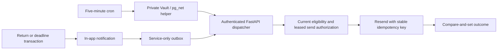

# Phase 3 Slice 4 — Email notifications design

**Date:** 2026-11-03. **Status:** Approved by the user on 2026-11-03, including the existing bounded retry/quota behavior. The user requested the [implementation plan](../plans/2026-11-03-phase3-email-notifications.md). This document does not claim implementation, independently observed sending-domain verification, hosted provisioning, or delivery.

**Baseline:** local `main` at `c3369cd`, which includes the merge of Slice 3 PR #6. Slices 1–3 are recorded as verified. Preserve their application behavior, notification receipts, upgrade proofs, and existing local worktrees.

**References:** [Phase 3 proposal](../../next_steps/PHASE_3_CLASSROOM_ACTIVITIES.md), Q6/Q8–Q10 and §5; [Slice 3 design](2026-11-02-phase3-in-app-notifications-design.md); [ADR 0005](../../adr/0005-transactional-notifications-and-scheduling.md); `AGENTS.md` §5–§6.

## 1. Goal and scope

Send an optional, minimal email to each linked parent when work is returned or its effective deadline is within 24 hours. The in-app notification remains the durable event and the place to read details. One global account preference defaults on; in-app notifications remain enabled.

This slice adds a service-only outbox, recoverable claims, bounded FastAPI dispatch through Resend, a Vault-backed five-minute HTTP invocation, and teacher/parent settings. It does not change the deadline sweep's 15-minute cadence or accepted event identities. Scores, worksheet processing, research exports, points, comments, and worker count retain their current contracts.

No historical notification is converted to an email during migration. Deployment, Resend/DNS provisioning, Vault values, and any real recipient smoke test are operational follow-up steps with their own evidence. Automated verification never sends email.

**Sender prerequisite (user-confirmed, 2026-11-03):** A verified Resend sending domain already exists. The user will supply sender details later. Domain verification was not independently inspected; implementation can use stubs while the concrete sender address and environment credentials remain unconfigured.

### 1.1 Approved refinements

The original proposal leaves recovery and stale-event behavior unspecified. This design resolves them as follows:

| Detail | Approved contract |
|---|---|
| Personalization | Fixed generic wording and a login link; no child name or activity title. `student` has only `full_name`, so deriving a reliable first name would require an additional product/data decision. This narrows Q9/§5.3's permitted content. |
| Current eligibility | Recheck parent linkage, confirmed Auth address, preference, archive state, and event relevance immediately before authorizing each send. |
| Opt-out | Off at event time or at dispatch means terminal `skipped`; enabling later never replays skipped emails. |
| Old reminders | Skip changed deadlines, completed/pinned work, and resolved/superseded Return requests. |
| Retry recovery | Leased claims, a stable Resend idempotency key, identical-payload checks, at most three reserved send attempts, and a one-hour retry window. |
| Delivery meaning | `sent` means Resend acknowledged acceptance; it is not proof of inbox delivery. |

## 2. Repository findings

1. `writewise_internal.put_notification` claims a durable delivery key and inserts the public notification in the same transaction as its originating coursework mutation or SQL deadline sweep. Extend this helper to insert the corresponding outbox row before it returns. No independent Python enqueue or broad trigger is needed.
2. The receipt table survives deletion of a submission/public notification and prevents the same event from being emitted again. Email must preserve that existing deduplication boundary rather than re-create notifications or derive new events from portal reads.
3. Deadline notification keys already include exact effective-deadline epoch microseconds. Queue `due_at` as a typed timestamp at insertion, using the existing helper/key contract; do not compare rounded browser timestamps or parse arbitrary free-form key fragments at dispatch.
4. `active_submission` already centralizes counted attempts, including explicit pins and Return barriers. Scheduler/email eligibility must reuse it and must not require grades or release to regard work as completed.
5. Parent activity access includes historical submissions after reassignment. The existing service-side assignment helper and current `teacher_student` relationship are appropriate for deadline reminders; a returned historical attempt needs the separate relevance rule in §5.
6. Teacher and parent profile reads/updates already use owner RLS. Add preference fields to those existing profile reads and use the same account ownership boundary. Do not put preferences in user-editable Auth metadata.
7. Public profile email fields are browser-editable under existing profile policies. Resolve the sending address from the current, confirmed Auth account instead; never trust an event payload, profile email, or caller-supplied recipient.
8. The backend uses service-only PostgREST RPCs. Keep that transport for queue operations; no resident raw-Postgres connection pool or extra application worker is necessary. A narrow private helper can read the required Auth address without granting broad browser or service table access to `auth.users`.
9. `httpx` is currently transitive. If the adapter uses its async client directly, declare it as a direct, deliberately selected dependency and update `uv.lock`; no Resend SDK is needed for one documented endpoint.
10. CI has migration replay, three legacy upgrade proofs, generated database/OpenAPI comparisons, full pytest, and a security-advisor error gate. Extend these rather than replacing them. Existing records about Docker availability or CI publication are historical, not a fresh environment check or authorization to change hosted state.

## 3. Architecture and alternatives

**Recommended:** transactional SQL outbox → existing FastAPI service → Resend. One named pg_cron job calls a private Vault-backed `pg_net` helper every five minutes. The endpoint processes a bounded number of rows, and each provider request happens after its database transaction has committed. This follows the accepted Q9 topology and reuses the Slice 3 transaction boundary.

**Alternative: send directly after Return or during the deadline sweep.** A provider outage would delay requests, and a crash between the coursework commit and sending could lose email. Sending inside the SQL transaction would also hold business locks across the network. Reject this alternative.

**Alternative: external queue/worker or Edge Function dispatcher.** These can offer independent throughput but introduce another execution/deployment boundary for a pilot-scale feature. They depart from the accepted FastAPI dispatcher; defer unless measured load justifies revisiting the design.

## 4. Data and transaction contract

### 4.1 Account preference

Add `email_notifications boolean not null default true` to both `public.teacher` and `public.parent`. Existing accounts receive true. Existing own-profile SELECT/UPDATE policies govern access; tests prove an account cannot read or change another account's preference. Explicit grants must be reviewed alongside RLS rather than relying on platform defaults.

The dispatch eligibility source is the linked recipient's parent row. The teacher preference is saved and displayed consistently, although the two email-eligible event types currently target parents only. A future email type must be separately approved; adding a preference does not expand the event catalog.

### 4.2 Service-only outbox

Create `public.email_outbox` through a new versioned migration. Enable RLS with no browser policies, revoke all privileges from `PUBLIC`, `anon`, and `authenticated`, and grant only required table operations to `service_role`. All public RPC entry points revoke default `PUBLIC` execution and grant execution only to `service_role`; private helpers remain in the unexposed `writewise_internal` schema.

| Field | Type / rule | Purpose |
|---|---|---|
| `id` | UUID primary key | Stable opaque delivery identity |
| `notification_id` | UUID unique, non-null FK to `notification`, cascade delete | Exactly one outbox row per newly emitted notification |
| `status` | Text check: `pending`, `processing`, `sent`, `failed`, `skipped` | Explicit delivery lifecycle |
| `due_at` | Nullable `timestamptz` | Exact event deadline for `due_soon`; null for Return |
| `attempts` | Integer, 0–3, default 0 | Durable reservations for external send attempts, including crashes after reservation |
| `next_attempt_at` | Non-null `timestamptz`, default database now | Earliest retry/claim time |
| `claim_token` | Nullable UUID | Opaque compare-and-set token for the current lease |
| `lease_expires_at` | Nullable `timestamptz` | Two-minute claim recovery deadline |
| `first_attempt_at` | Nullable `timestamptz` | Start of the one-hour retry window |
| `payload_sha256` | Nullable fixed-length SHA-256 hex digest | Verify retry payload equality without storing recipient/body snapshots |
| `provider_message_id` | Nullable bounded text | Acknowledged opaque Resend message ID |
| `last_error` | Nullable bounded allowlisted code | Safe failure/skip category; never raw provider text |
| `created_at`, `sent_at` | `timestamptz`; `sent_at` nullable | Queue age and acknowledged acceptance time |

Constrain processing rows to have a token and lease, other states to have neither, and sent rows to have a provider ID and `sent_at`. Keep first-attempt time and digest paired; attempts greater than zero require both. Validate the event/deadline pairing in the insertion and preparation helpers using the referenced notification type. No email address, name, activity title, note, score, rendered body, or arbitrary provider JSON is copied into the outbox.

Indexes: the unique `notification_id` constraint; a partial ready index on `(next_attempt_at, created_at, id)` for pending rows; and a partial expired-lease index on `(lease_expires_at, id)` for processing rows. Existing notification foreign-key indexes cover joins to recipients/work. Avoid indexing terminal status history without a demonstrated query.

Deleting a notification cascades its outbox row. Existing durable notification receipts prevent this deletion from re-arming an email. Deletion after external acceptance cannot recall an email; generic content limits what can remain in the recipient's inbox. Keep terminal rows for pilot operation until normal owner/activity/student cleanup, with no new bulk retention feature in this slice.

### 4.3 Atomic enqueue

Extend the existing private notification helper without changing its callers' event identities. On an actually inserted `submission_returned` or `due_soon` notification, insert exactly one outbox row in the same transaction. Insert `skipped` with code `preference_off` if the parent preference is already off; otherwise insert `pending`. Ignore notification read state.

For `due_soon`, obtain the typed effective deadline while holding the originating activity lock, and pass or resolve it through a typed helper contract. Existing callers must still compile and the existing deadline key must match that same timestamp at microsecond precision. Other notification types never create outbox rows. A new parent link does not replay old notifications/emails.

Failure of any outbox insert rolls back the new notification, its receipt, and its originating coursework change. Provider availability never participates in this transaction. Migration does not scan or queue pre-existing notifications, including unread ones; do not backfill historical email.

## 5. Eligibility immediately before sending

Preparation rechecks these predicates from current database state. A durable queue row is evidence that an event happened, not permanent permission to send.

Common eligibility:

- The notification and referenced activity/student still exist; the activity is unarchived.
- The recipient has an existing parent profile, is still linked through `student_parent`, and has email enabled.
- The current Auth account exists, has a nonblank confirmed email, and is not deleted or currently banned. Read only the required fields in a narrow, private, restricted helper. Never return the full Auth row or profile email.
- The activity's teacher still has the student in their roster. Do not send reminders about relationships the teacher no longer manages.
- The event is one of the two allowlisted email types, and its outbox timestamp metadata is valid.

| Event | Additional current-state predicates |
|---|---|
| `due_soon` | Student is currently assigned to this activity under the existing service-side roster/assignment helper; current effective due equals outbox `due_at` exactly; preparation time is at or before due and due is no more than 24 hours ahead; no `active_submission` exists. |
| `submission_returned` | Target attempt still has status `returned` for this student/activity; it is the latest Return by `(returned_at, id)`; no `active_submission` exists; no later completed attempt by `(created_at, id)` has resolved that request. Current assignment is not required when retained historical work remains visible to this still-linked parent and owning teacher. |

Completed draft/ungraded work and explicit pins suppress reminders just like released work. Processing/rejected retries do not resolve a Return or suppress due reminders. A historical Return of an older attempt does not request another upload when newer completed work already exists. A later Return supersedes an unsent older Return email. Returning with an already-passed deadline still permits the Return email while its request is outstanding; it does not create a due-soon email for that past deadline.

Terminal skip categories include `preference_off`, `recipient_unavailable`, `relationship_revoked`, `activity_archived`, `event_obsolete`, `deadline_changed`, and `payload_changed`. Missing related rows may cascade-delete the outbox instead. In-app notifications and read states are preserved by skips. Reading a bell notification alone does not suppress email, and reenabling email does not revive terminal rows.

**Concurrency boundary:** lifecycle operations and preparation follow activity-before-outbox locking. After acquiring the activity lock, perform a fresh eligibility query before reserving a send. Preference/link/Auth reads use that query's committed snapshot; a change committed before this check must be honored. No business or outbox lock remains held during provider I/O. A preference/link/work change after authorization may race with an email already in flight; it cannot recall an accepted message. This is an explicit limit, not a promise of atomicity between Postgres and Resend.

Slice 5 must add `excused` suppression to both the existing deadline sweep and these preparation predicates when that field is introduced. Do not create a partial points/excused schema here.

## 6. Claim, preparation, send, and outcome

Use small service-only RPCs and private implementation helpers. Most execute as security invoker. If reading canonical Auth details needs elevated privileges, use one narrow security-definer helper in the private schema with an empty search path, fixed qualified references, revoked browser execution, and only the minimal returned fields. The Vault scheduler helper is separately restricted to the database job owner.

1. **Recover/claim:** in a short transaction, recover expired processing leases, then claim one ready pending row ordered by `(next_attempt_at, created_at, id)` using `FOR UPDATE SKIP LOCKED`. Set a new random token and a two-minute lease, and return IDs/type/deadline only. Do not increment attempts for a claim alone. A bounded recovery scan must not monopolize dispatch.
2. **Prepare context:** with that token, lock the activity first, then the outbox row, and recheck current eligibility using fresh statements after the activity lock. Invalid rows become terminal skipped. Return only the canonical email and fixed-template inputs needed by the backend, never score-bearing context. This lookup does not itself reserve an external send.
3. **Authorize payload:** Python renders the fixed versioned payload and computes SHA-256 over a canonical serialization of exactly the Resend request body, including sender, recipient, subject, HTML, text, and links. A second short RPC rechecks eligibility/token, verifies the still-current address against the proposed payload address, and atomically reserves an attempt. On first reservation, set the digest/time; on retries require the same digest. A changed recipient, template, sender, or configured app URL yields `skipped/payload_changed` instead of changing a previously used payload. Return an explicit allowed/denied result; HTTP must only follow an allowed result.
4. **Send:** outside the transaction, make one bounded async HTTP request to Resend with `Idempotency-Key: writewise-email/<outbox UUID>`. No SDK retry loop, new key, background task, or in-request sleeping. HTTP transport retries are disabled; each external request consumes its own durable reservation.
5. **Finalize:** compare-and-set using ID, processing status, current claim token, and a valid lease. Record acknowledged success, a terminal failure, a skip, or pending-with-retry. Clear claim/lease on transitions out of processing. An old owner cannot finalize a reclaimed row. A result lost after acceptance is recovered by retrying the same key/payload within the permitted window.

Every eligibility-related send reservation checks the fresh Auth address and database relationships again, not merely the context gathered in step 2. Do not expose arbitrary payload or recipient selection through the internal HTTP endpoint. Service-only RPC inputs are not public application API capabilities.

### 6.1 Bounds and recovery semantics

- At most 10 claimed rows and 20 seconds of total dispatcher work per invocation. Claim one at a time; do not lease a large batch that will sit unused.
- Apply explicit timeouts to database operations and an overall five-second provider attempt budget (including connect/write/read); refuse to start a new provider attempt without enough remaining invocation budget to finalize it. Use a monotonic invocation clock and database time for durable deadlines.
- At most three durable send reservations. A crash after reservation may consume a slot without sending; this favors a strict bound over unbounded resend ambiguity.
- Retry transient failures after five minutes following reservation 1 and fifteen minutes following reservation 2. A valid provider `Retry-After` can postpone that time; do not sleep. If it would exceed the one-hour first-attempt window, terminally fail instead.
- At or beyond one hour from the first reservation, make no additional external send. Resend currently retains idempotency keys for 24 hours; the smaller local window leaves substantial safety margin. Never generate a new key to retry a terminal row.
- Expired leases with fewer than three reservations and a still-open window become ready pending; fresh eligibility/digest checks still apply. At the limit, finalize `failed/delivery_unknown` when no acknowledged outcome is available, rather than making a fourth request.
- A claimed row that never received a reservation has no first-attempt deadline yet. It can be reclaimed, but event relevance still expires due reminders naturally. Claim and recovery alone do not use provider attempts.
- If the invocation budget ends before a send reservation, safely release its unused claim to pending. If it ends or the process dies after reservation, use the same lease-recovery path; do not invent a success result.

Resend `sent` acknowledgement and the database outcome are separate transactions. This provides bounded, idempotent retry behavior within the documented provider window, not an unconditional exactly-once delivery guarantee. Even an acknowledged message may later bounce; bounce webhooks, provider reconciliation, manual resend controls, and a delivery dashboard are outside this slice.

### 6.2 Provider failures

| Outcome | Queue action |
|---|---|
| Successful response with valid opaque message ID | `sent`; store only ID and database acceptance time |
| Timeout, connection error, malformed success, HTTP 5xx | Retry within limits; classify as unknown/transient without retaining response text |
| HTTP 429 rate limiting or quota exhaustion | Retry no earlier than the safe provider hint/local delay; stop this invocation to avoid draining attempts across a whole queue |
| HTTP 409 `concurrent_idempotent_requests` | Retry same key and payload later |
| HTTP 409 `invalid_idempotent_request` | Terminal failure; never change the key to bypass the conflict |
| HTTP 400/401/403/422 or other permanent rejection | Terminal failure for the attempted row; stop this invocation for provider-wide credentials/domain/configuration errors |
| Database unavailable before reservation | No provider request; return a sanitized infrastructure error |
| Database unavailable after possible acceptance | Preserve lease/attempt evidence; abort invocation and recover later with the same key |

Normalize provider outcomes into a finite local code catalog such as `provider_timeout`, `provider_unavailable`, `provider_throttled`, `provider_rejected`, `provider_configuration`, `idempotency_conflict`, `delivery_unknown`, and `retry_window_expired`. Unknown provider error names become a generic category. Never store/log an exception string, response body, recipient, request body, or authorization header. An individual expected provider failure need not fail the entire HTTP invocation after its queue outcome is persisted.

## 7. HTTP and configuration contract

### 7.1 Dispatcher endpoint

`POST /api/internal/dispatch-emails` accepts no caller-selected recipient, row ID, limit, URL, or template. Server constants supply the bounds. Authenticate `X-Dispatch-Secret` with a constant-time comparison against a nonblank configured secret before reading or mutating the queue. A teacher/parent JWT or service-role bearer token alone does not substitute for the dispatch secret. No browser action invokes this endpoint.

Success: HTTP 200 with typed nonnegative aggregate counts: `{ claimed, sent, retried, failed, skipped }`. All counts describe this invocation's acknowledged outcomes; they are not an inbox-delivery report. An empty queue is a zero-count success. Infrastructure failure after partial work returns an error; already committed queue outcomes remain durable.

| Condition | Envelope |
|---|---|
| Missing/wrong/empty dispatch authentication | 401 `UNAUTHORIZED`, fixed message and empty details |
| Authenticated request while email dispatch is disabled | 503 `EMAIL_DISPATCH_UNAVAILABLE`, fixed message and empty details |
| Queue/infrastructure failure | 500 `INTERNAL_ERROR`, fixed message and empty details |

Catalog the new 503 code in `docs/API_SPEC.md` §2.4. Missing headers must reach the deliberate 401 path instead of FastAPI's default validation 422. Scope the header authentication scheme correctly in OpenAPI; regenerate `frontend/types/api.ts` from the real schema even though the portal has no dispatcher client. The dispatcher catches/sanitizes failures before the general exception handler can log provider objects containing PII.

### 7.2 Backend settings

| Setting | Default / validation |
|---|---|
| `EMAIL_DISPATCH_ENABLED` | False; explicit activation gate for development and deployment |
| `EMAIL_DISPATCH_SECRET` | Empty secret by default; nonblank strong secret required when enabled |
| `RESEND_API_KEY` | Empty secret by default; required when enabled; backend only |
| `EMAIL_FROM` | Empty by default; configured sender on a verified domain required when enabled |
| `APP_BASE_URL` | Empty by default; canonical frontend origin required when enabled; HTTPS except explicit localhost development |

Use secret-aware settings types for keys/secret, and validation messages that name missing setting names without echoing input values. Enabled incomplete configuration fails startup with a fixed diagnostic. Disabled configuration starts normally and performs no delivery. The Resend API origin is fixed in the adapter, not supplied by an HTTP request or Vault. Validate `APP_BASE_URL` as a plain origin without credentials, query, or fragment; construct login/settings paths from it. Reject header newlines in configured sender values.

Select and pin a compatible direct HTTP-client dependency through normal lockfile tooling if necessary. Preserve the single Uvicorn worker, use async I/O for the provider, and keep the existing app runnable when email settings are absent.

## 8. Cron, Vault, and deployment

Provision pg_net and the Vault extension through versioned migrations using the actual supported extension/schema names discovered from the installed CLI/stack. Do not guess CLI flags or recreate/drop an existing extension just to move it. Keep the schemas unexposed, use explicit object grants, and check advisors.

Register exactly one named job, `writewise-email-dispatch`, with `*/5 * * * *`. Its SQL text calls only `writewise_internal.request_email_dispatch()` and contains no secret, backend origin, recipient, or email payload. Re-registering the named job replaces it rather than adding copies.

The private scheduler helper reads two uniquely named Vault entries, `writewise_backend_url` and `writewise_email_dispatch_secret`. Resolve the configured backend origin plus the fixed dispatcher path; allow HTTPS or explicit localhost test destinations only. With absent/blank entries, return no request ID and do no network work. Invalid or duplicate configuration produces a fixed operator diagnostic without values; never choose an arbitrary row. Use a bounded `net.http_post` timeout longer than the endpoint's 20-second budget (30 seconds), JSON `{}`, and only the required content-type/dispatch headers.

The scheduler helper is callable only by the job owner, not by browser roles or a new public RPC. Vault values must not appear in migration files, cron command strings, logs, or generated types. Resend's key stays only in backend environment settings and is never sent to the database. The dispatch secret necessarily passes through pg_net's private request queue; do not expose that schema, and explicitly revoke browser/PUBLIC access to request/response data and direct network invocation where compatible with the installed extension. Verify these grants with actual role queries.

pg_net HTTP requests start after their transaction commits, and its request/response tables are not a durable email queue. Lost HTTP invocations are harmless: the next cron invocation finds the durable SQL outbox. Do not log a successful `net.http_post` request ID as proof that the backend or email provider succeeded. Diagnose through aggregate endpoint results and outbox codes without dumping Vault or network headers.

Operational activation order:

1. Verify the sender domain in Resend and disable open/click tracking for these classroom notices. Document sender/DNS setup; do not fabricate a sender domain or publish DNS during code implementation.
2. Deploy/review code and versioned migrations through the established workflow; apply only to the explicitly authorized environment.
3. Configure the backend sender, canonical frontend origin, Resend key, and dispatch secret with dispatch initially disabled.
4. Provision the matching backend-origin/secret Vault values outside source control using a documented, non-echoing operator procedure.
5. Enable backend dispatch after checks against synthetic data. A real email smoke test requires an explicitly designated recipient; record acceptance separately from inbox receipt.

Disabling backend dispatch stops future claims/sends; in-flight provider calls may finish. Removing scheduler Vault entries stops future HTTP invocations. Neither operation rewinds sent/skipped/failed states or replays historical notifications when reenabled. Rotation updates backend and Vault values in a controlled order and tests that rejected calls mutate no rows.

## 9. Templates and account settings

### 9.1 Fixed, versioned templates

Emit both plain text and small accessible HTML with equivalent wording. Template v1 uses:

- Return subject: **WriteWise: another attempt requested**. Body: “Your child's handwriting activity needs another attempt. Sign in to WriteWise to view the teacher's feedback.”
- Due-soon subject: **WriteWise: an activity is due soon**. Body: “Your child has a handwriting activity due within 24 hours. Sign in to WriteWise to check the deadline.”
- Primary link: canonical `/login`, with no student/activity/submission IDs, authentication token, email address, or user-controlled redirect in the URL.
- Footer: “You can change classroom email updates in Account Settings.” Link to canonical `/parent-settings`, which retains normal sign-in authorization.

No name/title interpolation, remote image, attachment, tracking pixel, measurement, grade, band, teacher note, rejection detail, or comment body is included. Escape configured URLs in HTML and construct all markup from fixed template code. Use a stable versioned renderer and canonical serialization; deployment changes must not silently alter the payload of an already attempted retry. A digest mismatch terminally skips it under §6 rather than creating a new message key.

The login link deliberately leads to normal portal access. It is not a magic login, email-read acknowledgement, or promise to open a particular worksheet. Current notification deep links remain in the authenticated bell.

### 9.2 Settings UI

Add a shared Notifications settings card in both existing settings screens, following their current label/card/tokens and existing checkbox/switch primitives. The parent control is **Email me** with the helper: “Get email when work needs another attempt or an activity is due soon. In-app notifications stay on.” Teacher copy must explain that these classroom emails currently go to parents; do not imply teacher email events already exist.

Load the actual preference under verified account RLS. A failed/missing profile read shows a retry/error state and disables mutation; never substitute `true` and silently overwrite the user's choice. Update only `email_notifications` on the current account's actual profile table under RLS, using verified identity and account-change guards. Require one returned owned row to confirm success; a zero-row update is not a success. Use fixed UI error copy or existing stable error codes, never branch on database message text.

Make save state explicit with the existing form conventions; disable duplicate submissions, keep the saved value on failure, announce success/error without stealing focus, and refresh the server profile after success. In-flight writes must not affect a newly signed-in account. No Auth metadata sync is needed for this preference. Verify keyboard labeling, mobile layout, loading, refresh persistence, errors, and both account roles manually.

## 10. Implementation boundaries and documentation

This is a design map, not the checkbox implementation plan. After written-spec approval, the writing-plans step must turn these boundaries into ordered, independently testable tasks.

| Area | Expected files / responsibility |
|---|---|
| Database | New timestamped migrations for preferences/outbox, helper extension, claim/preparation/finalization functions, and network/Vault/job permissions. Generate migration filenames through the installed Supabase CLI. |
| Delivery domain | Focused `backend/app/email/` modules for fixed templates, Resend transport/error normalization, and bounded orchestration; avoid putting all queue/state/provider logic in a route. |
| HTTP/config | `backend/app/api/internal_emails.py` plus typed contracts; router registration in `app/main.py`; secret-aware config and example env fields. |
| Backend verification | Route/adapter/template/orchestrator unit tests; real queue/event/permission/race tests; synthetic pre-Slice-4 upgrade proof; extend deterministic job pause/restore fixtures. |
| Frontend | Shared notifications settings card and focused preference transport; both account settings pages; existing UI primitives and account verification patterns. |
| Contracts | Generated actual `frontend/types/database.ts` and `frontend/types/api.ts`, not the obsolete `frontend/src/types/` examples. |
| Promoted docs | `API_SPEC.md`, `DATABASE.md`, `PRD.md`, `ARCHITECTURE.md`, `SECURITY.md`, `DEPLOYMENT.md`, `DESIGN.md`, `TESTING.md`, proposal and implementation tracker; extend ADR 0005 or add a narrowly focused delivery ADR. |

Implementation must preserve all seven existing notification types/events and the three existing upgrade proofs. Do not rewrite old migrations or opportunistically refactor unrelated Auth/settings behavior. Record verified, merged, provisioned, and delivered states separately.

## 11. Acceptance and verification

1. **Queue/RLS:** real signed-in browser-role clients cannot read or write outbox rows, call delivery RPCs, access private helpers/Vault/network tables, choose recipients, or alter another account's preference. Explicit service grants work after the platform grant-default change. Do not use service-role calls as proof of RLS isolation.
2. **Transactional events:** every new Return/due-soon notification gets one corresponding outbox row per recipient; other events get none. Event deduplication, overlapping parents/siblings, read state, concurrent emission, deletion/receipt retention, and injected outbox failure preserve the full existing transaction contract. Opted-out recipients keep their in-app event with skipped email.
3. **Eligibility:** current versus former linked parents; canonical confirmed Auth address versus edited profile email; absent/deleted/banned recipient; archives; roster/assignment removal; both activity modes; exact 24-hour/due boundaries; effective overrides; same deadline under equivalent timezone offsets; changed/restored deadlines; active ungraded/draft/released/pinned work; completed versus processing/rejected retries; historical Return and supersession. Commit-before-preparation race tests must use observed locks/barriers, not timing sleeps.
4. **Queue concurrency:** simultaneous dispatch claims never own the same lease; no database lock spans a provider call; expired claims recover; stale tokens cannot finalize; attempts reserve before HTTP; crashes before/after reservation and after provider acceptance respect three reservations and the one-hour window. Exercise actual RPCs, not an in-memory imitation of SQL behavior.
5. **Idempotency:** accepted request followed by lost finalization retries the identical body and stable key. Changed address/sender/URL/template digest skips before HTTP. Late recovery does not resend beyond the window or replace a terminal key. Distinguish provider acceptance from delivery-unknown and inbox delivery.
6. **Provider/bounds:** stubbed HTTP covers success IDs, timeouts, malformed success, 5xx, 429/Retry-After, both 409 variants, permanent rejection, credentials/domain stop conditions, count/time budgets, DB failure, lease loss, and cancellation. No automatic transport retries or real provider requests. Capture logs and prove injected names, addresses, notes, scores, headers, raw responses, and secrets are absent.
7. **HTTP/config:** missing/wrong/empty secret gives deliberate 401 before queue access; browser bearer-only requests fail; correct secret with dispatch disabled gives cataloged 503; incomplete enabled configuration fails safely without echoing secrets; fixed provider origin and validated app URL prevent caller-selected destinations. Responses contain counts/codes only.
8. **Scheduler:** one named five-minute dispatch job and the unchanged 15-minute deadline job; no values embedded in command text; absent Vault configuration is a no-op; invalid/duplicate configuration does not send; synthetic loopback HTTP invocation tests verify path/header/body after commit. Pause/restore both wall-clock jobs during deterministic tests, and prove browser roles cannot inspect secret-bearing queues or invoke private network helpers. Tests use no live Resend or hosted resets.
9. **Upgrade/contracts:** seed a synthetic pre-Slice-4 schema, upgrade through actual migrations, prove existing preferences default on, historical emails do not queue, prior notifications/work/scores remain unchanged, and job/grant configuration is correct. Retain all earlier upgrade checks and generated-type/security-advisor gates.
10. **Required checks:** backend Ruff, frontend ESLint/TypeScript, production frontend build, generated API/database comparisons, security advisors, and full backend pytest on an ephemeral Supabase stack. Use CLI help and confirm localhost targets before any reset. If Docker remains unavailable, complete local database-free verification and report the exact remaining CI gates; publishing is a separate authorized action.
11. **Manual portal/operations:** both settings roles, preference persistence and failures, account switch safety, linked-parent opt-out without affecting another parent, preserved bells/read state, mobile/keyboard behavior, synthetic provider preview, and explicit sender/Vault/Resend activation evidence before claiming deployed email. Slice 4 stays unverified until its applicable gates close.

## 12. Sources checked during design

Reviewed on 2026-11-03. The markdown changelog URL returned an unsupported-content response in the web reader; the HTML index and relevant linked change were inspected instead. These references support the technical contract, not a claim that any hosted configuration was inspected.

- [Supabase changelog](https://supabase.com/changelog) and [explicit API grants change](https://supabase.com/changelog/45329-breaking-change-tables-not-exposed-to-data-and-graphql-api-automatically): explicitly grant intended new-object access and test it alongside RLS.
- [Supabase pg_net](https://supabase.com/docs/guides/database/extensions/pg_net): asynchronous post-commit HTTP, request timeout argument, network schema permissions, and non-durable request/response tables. The durable email state belongs in our outbox.
- [Supabase Vault](https://supabase.com/docs/guides/database/vault): encrypted secret storage with privileged decrypted reads; keep values out of migrations/job text.
- [Supabase Cron quickstart](https://supabase.com/docs/guides/cron/quickstart): named scheduling and replacement semantics for the dispatch job.
- [Resend send API](https://resend.com/docs/api-reference/emails/send-email): the adapter sends the fixed sender/recipient/subject/HTML/text request and validates its returned message ID.
- [Resend idempotency](https://resend.com/docs/dashboard/emails/idempotency-keys): 24-hour retention, bounded key size, identical-payload requirements, and distinct conflict outcomes. This is why local recovery is bounded to one hour.
- [Resend errors](https://resend.com/docs/api-reference/errors): transient throttling/quota versus permanent request/auth failures; retain local safe categories rather than provider messages.
- [Resend verified domains](https://resend.com/docs/dashboard/domains/introduction): a verified owned sending domain is an activation prerequisite, with tracking controlled at the domain level.
